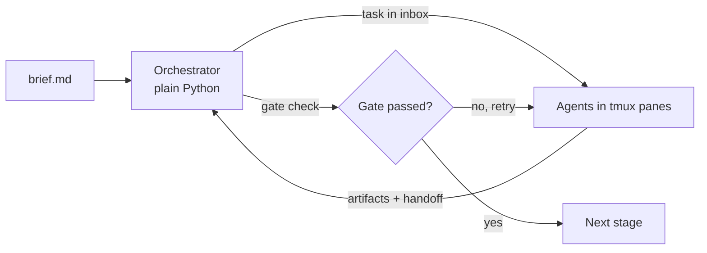

# Start here

## What you will learn

- What sdlc-mux is, in plain words, and what you see on screen when it runs.
- What "success" looks like after ten minutes.
- Which doc to read next.

## What it is

sdlc-mux is a command-line tool that runs a small virtual software team inside one terminal window. Each team member is an AI coding agent (Claude Code, Codex CLI, GitHub Copilot CLI, or an offline `mock` runner). One work item, for example a short product brief, moves through eight stages: discover, design, plan, build, test, review, release, retro.

Three ideas make it work:

- **Plain code is in charge.** A Python orchestrator moves the work item and checks the gates. No AI decides whether a stage passed.
- **Process comes from skills.** Every agent loads the shared `sdlc-protocol` skill, its own role skill, and the [Superpowers](09-superpowers.md) skills that role needs.
- **tmux shows it.** `sdlc up` opens one tmux window: a dashboard band on top and one labelled column per team section below.



## What success looks like

After ten minutes you have: `sdlc doctor` printing `[ok]` lines, a work item that reached `done` with the offline mock runner, and a tmux room you can open and close. You do not need Codex or Copilot for any of this. Windows requires WSL2 in v1.

## The ten-minute path

1. Install the prerequisites: [macOS](03-install-macos.md) or [Windows with WSL2](04-install-windows-wsl.md). Other routes are in [install alternatives](05-install-alternatives.md).
2. Check your machine with `sdlc doctor`.
3. Run the example brief offline with the mock runner.
4. Open the room with `sdlc up`, watch, and close it with `sdlc down`. See [running a team](11-running-a-team.md).

## Try it

The fastest check that everything is wired is the doctor:

```bash
uv run sdlc doctor
```
Run: yes, output below

```text
[ok]      python 3.12
[ok]      uv
[ok]      tmux
[ok]      runner claude (claude)
[ok]      sdlc skills missing in .claude/skills: sdlc-protocol, role-backend-engineer, ... (warning)
[ok]      superpowers for claude not verified (cannot check plugin installs on disk) (warning)
```

The long skills line is trimmed. `(warning)` rows are shown as `[ok]` because they do not fail the check. Now run the whole pipeline offline (the mock runner makes deterministic files and calls no network):

```bash
uv run sdlc run examples/expense-splitter.md --runner mock --workspace /tmp/sdlc-demo
```
Run: yes, output below (run in a scratch directory instead of `/tmp/sdlc-demo`)

```text
gate discovered: passed
gate designed: passed
gate planned: passed
gate built: passed
gate tested: passed
gate reviewed: passed
gate released: passed
gate retrospected: passed
expense-splitter: done
```

Next: [concepts](01-concepts.md). You can also run `sdlc learn` to read this page and the concepts page in the terminal.
