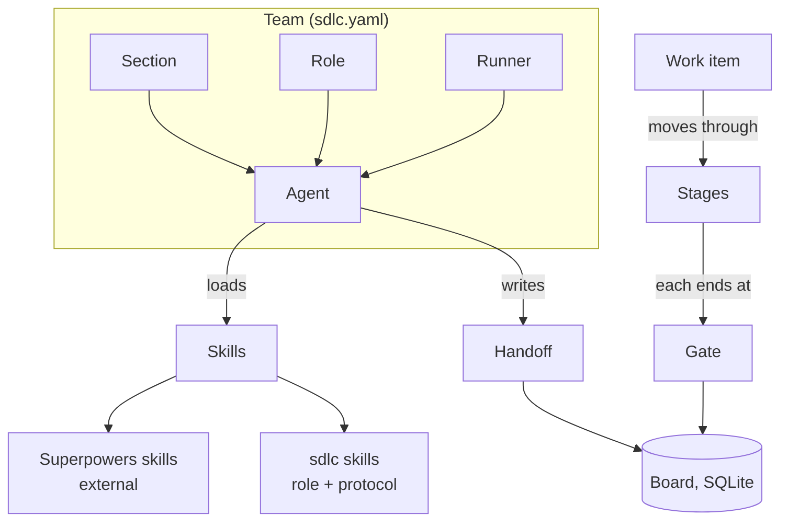

# Concepts

## What you will learn

Every term the rest of the docs use: section, role, agent, runner, skill, work item, stage, gate, handoff, board, and mode.

## The picture



## The terms

- **Section**: a group of roles shown together on screen. The default team has six: Discovery; Architecture & Delivery; Engineering; Quality; Governance; Operations.
- **Role**: an agent type with a mission, skills, inputs, outputs, and a definition of done. There are twelve. See [roles and skills](10-roles-and-skills.md).
- **Agent**: a running instance of a role bound to one runner. A role can have several instances; the default team runs two backend engineers.
- **Runner**: the program that powers an agent: `claude`, `codex`, `copilot`, or `mock`.
- **Skill**: a folder with a `SKILL.md`. Two kinds: **Superpowers skills** (external, installed from the Superpowers project, never copied into this repo) and **sdlc skills** (the twelve role skills and the `sdlc-protocol` skill shipped here).
- **Work item**: a unit of product value (a feature or story). The id is the brief's file name, so `examples/expense-splitter.md` becomes `expense-splitter`.
- **Stage**: one pipeline step: `discover`, `design`, `plan`, `build`, `test`, `review`, `release`, `retro`.
- **Gate**: a machine-checked condition that must hold before the item leaves a stage (required files exist and are valid, tests recorded as passing). Gates live in `gates.py`.
- **Handoff**: a Markdown message in a role's inbox or outbox saying what was produced, what is needed, and the status (`done`, `blocked`, `question`).
- **Board**: a SQLite database, the source of truth for each item's state. The item states run `idea`, `discovering`, `discovered`, `designing`, `designed`, `planning`, `planned`, `building`, `built`, `testing`, `tested`, `reviewing`, `reviewed`, `releasing`, `released`, `retrospected`, `done`. Illegal jumps (for example `idea` to `built`) are refused.
- **Mode**: `supervised` (the runner's normal approval behaviour; the agent asks before risky actions) or `autonomous` (headless, no prompts, limited to the workspace; opt-in). See [safety](14-safety-and-permissions.md).

## Try it

Look at the team definition that these terms come from:

```bash
head -13 sdlc.yaml
```
Run: yes, output below

```text
# Default team for sdlc-mux. Phase 0 defaults (plan.md D2): macOS, Claude Code only,
# mock first, 14 panes (13 agents + the dashboard).
# Codex and Copilot CLIs are not installed on this machine, so every agent uses the
# `claude` runner. Prompt.md section 7 assigns codex/copilot to some roles; switch those
# agents back once the binaries exist. For an offline demo use `sdlc run ... --runner mock`.
version: 1
mode: supervised                  # supervised | autonomous
defaults:
  os: macos
  demo_runner: mock
  max_panes: 14
superpowers:
  repo: https://github.com/obra/superpowers
```

Then read [architecture](02-architecture.md).
