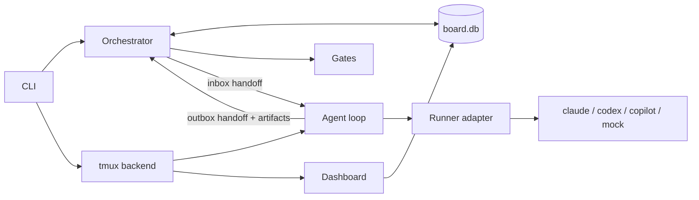
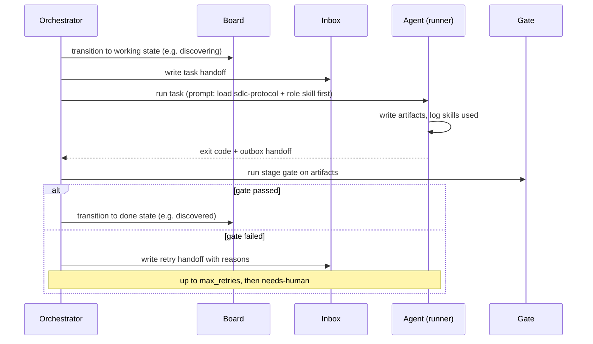

# Architecture

## What you will learn

- The components and how data flows between them.
- Why the board is SQLite.
- Why plain Python, not an LLM, owns the process.
- What happens, step by step, when one work item moves through one stage.

## Components

| Component | File | Job |
|---|---|---|
| CLI | `src/sdlc_mux/cli.py` | The `sdlc` commands. |
| Config | `config.py` | Reads and validates `sdlc.yaml` (unknown roles or stages, duplicate roles in a section, missing runner binaries). |
| Orchestrator | `orchestrator.py` | Walks the pipeline, runs gates, retries, enforces time limits. Plain Python. |
| Board | `board.py` | SQLite state machine for work items. Rejects illegal transitions. |
| Gates | `gates.py` | One validator per gate. The only code that decides pass or fail. |
| Handoffs | `handoffs.py` | Inbox and outbox Markdown messages. |
| Agent loop | `agent_loop.py`, `bootstrap.py` | What one pane runs: read inbox, build the prompt, call the runner, log, write the outbox. |
| Runners | `runners/` | One adapter per CLI (`claude`, `codex`, `copilot`) plus the offline `mock`. |
| Multiplexer | `multiplexer/` | The tmux backend; `zellij.py` is a stub that raises "not implemented in v1". |
| Dashboard | `dashboard.py` | A `rich` view of board counts, items, and the last 20 events. |
| Skills | `skills/` | The `sdlc-protocol` skill and twelve role skills, copied out by `sdlc skills sync`. |



## Files on disk

All state is under the workspace folder (default `workspace/`, ignored by git): `board.db`, `runs/<item>/` (brief, artifacts, `inbox/`, `outbox/`), and `runs/logs/<item>/<role>.md` (one event log per role, plus `orchestrator.md`).

## Why SQLite

One file, no server, transactions for free, and it survives `sdlc down`. Two panes can write at once without corrupting it. The board is the source of truth; `BOARD.md` is only a readable mirror. See [ADR 0002](adr/0002-sqlite-board.md).

## Why the orchestrator owns process, not an LLM

An agent can say "the tests pass" when they do not. A gate written in Python gives the same answer every time and can be tested with a passing and a failing fixture. Agents produce artifacts and report status; they never write gate status. A human can override a gate only with `sdlc approve`, which is logged. See [ADR 0003](adr/0003-orchestrator-owned-gates.md).

## One work item through one stage



## Try it

Run the pipeline in a scratch workspace and look at what the architecture wrote to disk:

```bash
uv run sdlc run examples/expense-splitter.md --runner mock --workspace /tmp/sdlc-demo
```
Run: yes, output below (see [start here](00-start-here.md) for the output; it ends with `expense-splitter: done`)

```text
expense-splitter: done
```

```bash
cd /tmp/sdlc-demo && find . -maxdepth 3 | sort | head -12
```
Run: yes, output below (listing from the scratch run, trimmed)

```text
.
./board.db
./runs
./runs/expense-splitter
./runs/expense-splitter/accessibility-checklist.md
./runs/expense-splitter/brief.md
./runs/expense-splitter/build
./runs/expense-splitter/business-rules.md
./runs/expense-splitter/data-dictionary.md
./runs/expense-splitter/design
./runs/expense-splitter/outbox
./runs/expense-splitter/plan.md
```

Event log of the orchestrator (gate checks):

```bash
head -8 /tmp/sdlc-demo/runs/logs/expense-splitter/orchestrator.md
```
Run: yes, output below (timestamps from the scratch run)

```text
2026-11-09T15:11:49+00:00 | orchestrator | gate-discovered | attempt 1: passed
2026-11-09T15:11:49+00:00 | orchestrator | gate-designed | attempt 1: passed
2026-11-09T15:11:49+00:00 | orchestrator | gate-planned | attempt 1: passed
2026-11-09T15:11:49+00:00 | orchestrator | gate-built | attempt 1: passed
2026-11-09T15:11:49+00:00 | orchestrator | gate-tested | attempt 1: passed
2026-11-09T15:11:49+00:00 | orchestrator | gate-reviewed | attempt 1: passed
2026-11-09T15:11:49+00:00 | orchestrator | gate-released | attempt 1: passed
2026-11-09T15:11:49+00:00 | orchestrator | gate-retrospected | attempt 1: passed
```

Next: [macOS install](03-install-macos.md).
