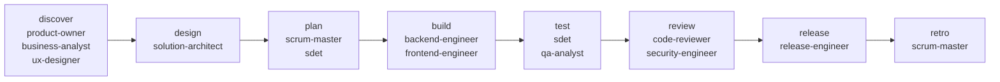

# Roles and skills

## What you will learn

- The twelve roles, what each is responsible for, and its Superpowers flow.
- How the pipeline connects them.
- How skills reach each runner.

## The pipeline



Each arrow is a gate: `discovered`, `designed`, `planned`, `built`, `tested`, `reviewed`, `released`, `retrospected`.

## Roles

Superpowers skills are listed in the order the role uses them (from `src/sdlc_mux/superpowers.py`, which the tests compare with the role skill files). Outputs are relative to `workspace/runs/<item>/`.

| Role | Section | Stages | Superpowers it uses | Main outputs |
|---|---|---|---|---|
| product-owner | Discovery | discover | brainstorming, writing-plans, verification-before-completion | `vision.md`, `stories/*.md` with Given/When/Then criteria |
| business-analyst | Discovery | discover | brainstorming, verification-before-completion | `business-rules.md`, `process-flow.md`, `data-dictionary.md` |
| ux-designer | Discovery | discover | brainstorming, verification-before-completion | `user-flows.md`, `screen-specs.md`, `accessibility-checklist.md` |
| solution-architect | Architecture & Delivery | design | brainstorming, writing-plans, verification-before-completion | `design/design-doc.md`, `design/adr/*.md` |
| scrum-master | Architecture & Delivery | plan, retro | writing-plans, dispatching-parallel-agents, subagent-driven-development | `plan.md` (task list), `retro.md` |
| backend-engineer | Engineering | build | using-git-worktrees, writing-plans, executing-plans, test-driven-development, systematic-debugging, verification-before-completion, requesting-code-review, finishing-a-development-branch | commits on a feature branch, `build/<task>-report.md` |
| frontend-engineer | Engineering | build | same as backend-engineer | same as backend-engineer |
| sdet | Quality | plan, test | writing-plans, test-driven-development, systematic-debugging, verification-before-completion | `test/test-plan.md`, `test/test-report.md` |
| qa-analyst | Quality | test | brainstorming, systematic-debugging, verification-before-completion | `test/qa-signoff.md` |
| code-reviewer | Governance | review | requesting-code-review, receiving-code-review, verification-before-completion | `review/review-report.md` with a verdict |
| security-engineer | Governance | review | brainstorming, systematic-debugging, verification-before-completion | `review/security-review.md` |
| release-engineer | Operations | release | writing-plans, executing-plans, finishing-a-development-branch, verification-before-completion | `release/release-plan.md`, `release/release-notes.md`, `release/go-no-go.md` |

Every role skill has the same ten sections: front matter, Mission, Load first, Superpowers flow, Inputs, Outputs, Definition of done, Handoff, Boundaries, Escalate when. The definition of done matches what the stage's gate checks.

The shared `sdlc-protocol` skill (five files) holds the rules every agent follows: check the inbox before and after, write only to your role's outputs, never change a gate status, never merge or push, and escalate by writing `needs-human.md`. The `sdlc board ...` commands it mentions are planned and not built in v1; agents report through their outbox handoff.

## How skills reach a runner

`sdlc skills sync` copies the protocol skill and the twelve role skills into `<root>/.claude/skills/` (Claude Code) and `<root>/.agents/skills/` (Codex and Copilot). It never writes a home folder.

## Try it

```bash
uv run sdlc skills sync --target-root /tmp/sdlc-proj
```
Run: yes, output below (first lines; it prints one `synced <path>` per folder, 26 in all)

```text
synced /tmp/sdlc-proj/.claude/skills/sdlc-protocol
synced /tmp/sdlc-proj/.claude/skills/role-backend-engineer
synced /tmp/sdlc-proj/.claude/skills/role-business-analyst
```

Then read one role skill, for example `skills/roles/product-owner/SKILL.md`, and compare its Outputs with the gate list above.
